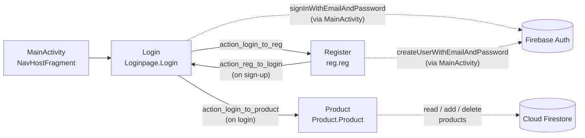

# SmartInventory

A small Android inventory app in Java. You sign in with Firebase Authentication (email/password), then add, view and remove products (a name and a quantity) stored in Cloud Firestore.

<!-- Screenshots: add images of the Login, Register and Product screens here, e.g.
<p align="center">
  
  
  
</p>
-->

## Overview

SmartInventory has a single activity. It uses the Jetpack Navigation component to switch between three fragments (Login, Register and Product). The package name (`com.firstapp.homework2`) and the Gradle project name (`HomeWork2`) suggest it started as a coursework assignment for learning Android with Firebase. Most of the UI text is in Hebrew. Some field hints and auth toasts are in English.

## Features

- **Sign-up** with `createUserWithEmailAndPassword`. The form checks that every field is filled in, that the two passwords match and that the phone number is exactly 10 digits. Errors appear inline on the Material `TextInputLayout` fields. After a successful sign-up the app goes back to Login.
- **Login** with `signInWithEmailAndPassword`. After a successful login the app opens the Product screen.
- **Current user**: the Product screen shows the signed-in user's email.
- **Product list**: shows every document in the Firestore `products` collection in a `ListView`.
- **Add product**: checks that the name and quantity aren't empty and that the quantity is an integer, writes a new document, then reloads the list.
- **Remove product**: tap a row to select it, then tap Remove to delete that document.
- **Feedback**: Toast messages for success and failure. Firestore errors are also written to Logcat.

## Tech Stack

| Area | Technology |
| --- | --- |
| Language | Java 11 (source/target compatibility) |
| Build | Gradle 8.10.2, Android Gradle Plugin 8.8.0, Kotlin DSL with a version catalog |
| SDK | `compileSdk`/`targetSdk` 35, `minSdk` 24 (Android 7.0) |
| UI | AppCompat, Material Components, ConstraintLayout, Navigation (Fragment/UI 2.8.6) |
| Backend | Firebase Authentication 23.1.0, Cloud Firestore 25.1.1 |
| Declared but unused | Firebase Realtime Database 21.0.0 |
| Testing | JUnit 4, AndroidX Test, Espresso (template tests only) |

## Architecture

`MainActivity` hosts a `NavHostFragment` that loads `res/navigation/navigation.xml`. The start destination is `login`. The Login and Register fragments call `MainActivity.login(...)` and `MainActivity.rege(...)`. Those methods call Firebase Auth and report the result through the `LoginCallback` and `RegCallback` interfaces. The Product fragment talks to Firestore directly.



**Data model:** one top-level collection, `products`. Each document has an auto-generated ID and two fields: `name` (string) and `quantity` (integer).

## Firebase Setup

This repository doesn't ship a usable Firebase config. Create your own project:

1. Create a project in the [Firebase console](https://console.firebase.google.com/).
2. Add an **Android app** with the package name `com.firstapp.homework2`. You can also change `applicationId` in `app/build.gradle.kts` and register that name instead.
3. Download your `google-services.json` and put it in `app/` (`app/google-services.json`). The build fails without it, because the Google Services Gradle plugin needs it. Don't commit it.
4. Under **Authentication > Sign-in method**, enable **Email/Password**.
5. Create a **Cloud Firestore** database and set security rules that let the app use the `products` collection.

**Example rules (a minimal starting point, not production-ready):** these let only signed-in users read and write `products`.

```
rules_version = '2';
service cloud.firestore {
  match /databases/{database}/documents {
    match /products/{productId} {
      allow read, write: if request.auth != null;
    }
  }
}
```

Every signed-in user can still read and change every product under these rules. See [Known Limitations](#known-limitations).

## Getting Started

**Prerequisites:** Android Studio (any version that supports AGP 8.8), JDK 17 (Android Studio bundles one), a device or emulator on API 24 or higher, and the Firebase setup above.

```bash
git clone https://github.com/wardkadan1/SmartInventory.git
cd SmartInventory
# add app/google-services.json, then:
./gradlew assembleDebug    # build a debug APK
./gradlew installDebug     # install on a connected device/emulator
```

You can also open the folder in Android Studio, let Gradle sync, and click **Run**.

## Known Limitations

- **Shared list:** products aren't tied to a user, so everyone who signs in sees and edits the same list.
- **Phone number** is validated on sign-up but never stored.
- **Unused code and dependencies:** the Firebase Realtime Database dependency is declared but never used. `ProductItem.java` isn't referenced anywhere. The fragments still contain unused `newInstance`/param boilerplate from the templates.
- **No real tests:** only the default `ExampleUnitTest` and `ExampleInstrumentedTest`.
- **No session handling:** the app always opens on Login, and there's no logout.
- **Hard-coded strings:** UI text is set in layouts and code, not in `strings.xml`. The app label is still `HomeWork2`.

## Project Structure

```
app/src/main/
├── AndroidManifest.xml
├── java/com/firstapp/homework2/
│   ├── MainActivity.java          # Nav host + Firebase Auth calls
│   ├── Loginpage/Login.java       # Login fragment
│   ├── reg/reg.java               # Register fragment + validation
│   └── Product/
│       ├── Product.java           # Product list (Firestore read/add/delete)
│       └── ProductItem.java       # POJO, currently unused
└── res/
    ├── layout/                    # activity_main, fragment_login, fragment_reg, fragment_product
    └── navigation/navigation.xml  # Nav graph
gradle/libs.versions.toml          # Dependency versions
```

## Author

**Ward Keadan**
- GitHub: [github.com/wardkadan1](https://github.com/wardkadan1)
- Portfolio: [wardkeadan.vercel.app](https://wardkeadan.vercel.app)
